# Home Assistant Device Cards

Compact, device-focused dashboard cards for Home Assistant.
One frontend library, independently configurable cards, no backend integration.

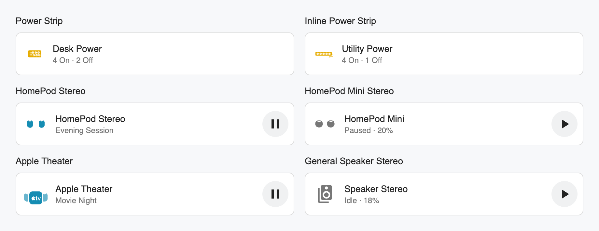

Overview and appliance screenshots use synthetic demo entities and states.
The Plant Monitor screenshot below shows live Home Assistant readings.

## Cards

### Toilet Seat

`custom:toilet-seat-card` wraps a real power switch in a compact device tile
with a monochrome seat silhouette. Open it for explicit On/Off commands and
native entity history. Unknown stays Unknown until HA reports a state;
explicit commands remain available for an online switch with unknown state.
Unavailable/missing entities disable power controls. Pending requests block
duplicates, errors are visible, and requests time out after 15 seconds.
No temperature, lid, occupancy or heating capabilities are inferred.

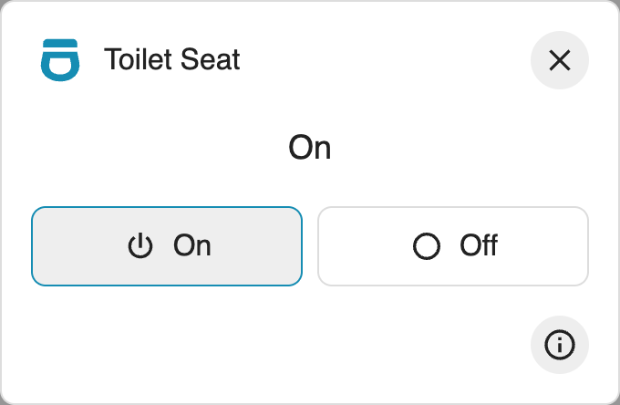

```yaml
type: custom:toilet-seat-card
name: Toilet Seat
entity: switch.toilet_seat
```

The visual editor accepts a switch entity and an optional display name.

### Plant Monitor

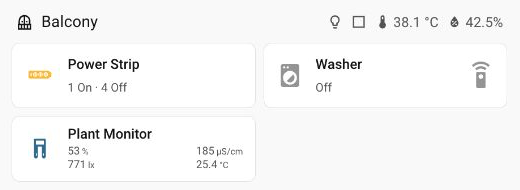

`custom:plant-monitor-card` uses the same half-width, single-row tile size as
Washer and Power Strip, with a twin-probe silhouette and four readings in a compact
two-by-two layout. Click the tile for moisture, conductivity, illuminance and
temperature details; each reading opens its native entity history.
Missing readings show Unavailable; zero remains a valid reading. No services
are called and no plant-health or care recommendations are inferred.

```yaml
type: custom:plant-monitor-card
name: Plant Monitor
moisture_entity: sensor.plant_soil_moisture
conductivity_entity: sensor.plant_soil_ec
illuminance_entity: sensor.plant_illuminance
temperature_entity: sensor.plant_temperature
```

Bind at least one sensor. Units come from each entity, and the visual editor
provides four independent sensor selectors.

### Dishwasher

`custom:dishwasher-card` uses the same compact tile and dialog as the other
appliance cards, with a theme-aware outline drawing instead of a realistic image.
Midea AC LAN provides backend entities, not a bundled frontend card.

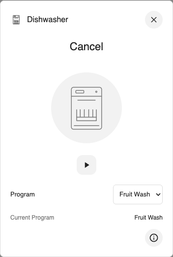
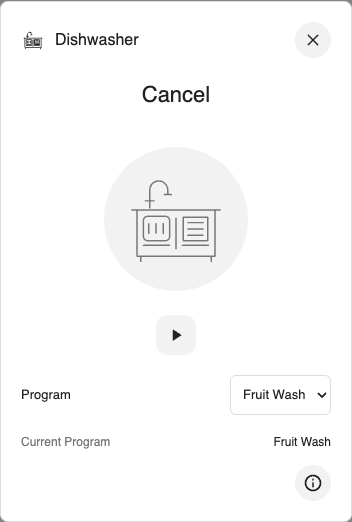

```yaml
type: custom:dishwasher-card
name: Dishwasher
icon_variant: cabinet # cabinet or sink
state_entity: sensor.dishwasher_status
progress_entity: sensor.dishwasher_progress
mode_entity: sensor.dishwasher_mode
mode_select_entity: select.dishwasher_mode_select
```

For Midea E1, selecting a program through the integration starts washing.
The visual editor offers Cabinet and Sink designs; the tile icon, dialog header
and central outline switch together. This setting never changes device control.
The card deliberately keeps dropdown edits local: only explicit Start, followed
by confirmation, calls `select.select_option`. It waits for Running or Delay
readback. Power Off, unavailable program controls, unknown/error states and
the neutral program disable Start. No raw protocol commands are generated.
Only bind `mode_select_entity` when its native selection action starts a cycle.
Other integrations may bind optional `start_entity`/`stop_entity` buttons instead.
State is required; the remaining bindings are optional. Running stages are
hidden while off, and the last program is not presented as an active cycle.
No door state, remaining time or missing controls are fabricated. Optional
`remaining_entity`, `fault_entity` and `finished_entity` use real entities only.
Start and Stop remain visible on the left of one control row, with Program on
the right. The real household dishwasher has no exposed Stop action, so its
Stop button is disabled and explains that limitation in its tooltip.
Browser checks use synthetic entities and never start a real wash.

The dialog includes a **Debug** snapshot, collapsed each time it opens: exact entity IDs,
raw states, attributes, HA change/update/report timestamps, start blockers,
locally selected versus reported program, and up to 30 state transitions observed
by this card. The last command records service acknowledgment separately from
the operation's Running/Delay confirmation, including service failures and
confirmation timeouts. These are current-card-session diagnostics, not backend
logs, device packet timestamps or persistent history. Missing fault entities do
not prove that the device has no faults. E1's raw `cancel` status remains unchanged
in diagnostics; the main display calls it **Stopped**, not Idle or a new error.

### Air Fryer And Pressure Cooker

`custom:air-fryer-card` and `custom:pressure-cooker-card` open a compact control
panel from a single status tile. Original solid SVG silhouettes share the
Washer tile's bare icon styling, sizing and theme colors, without circular backgrounds or shadows.
Existing Xiaomi Home entities remain the backend.

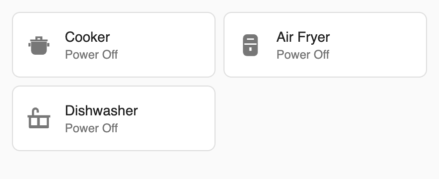

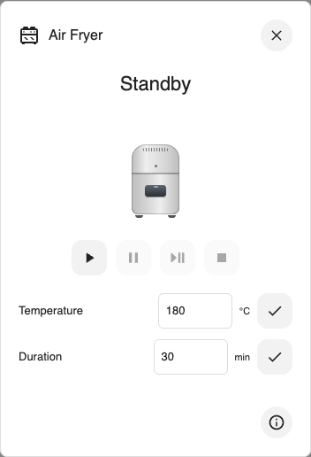
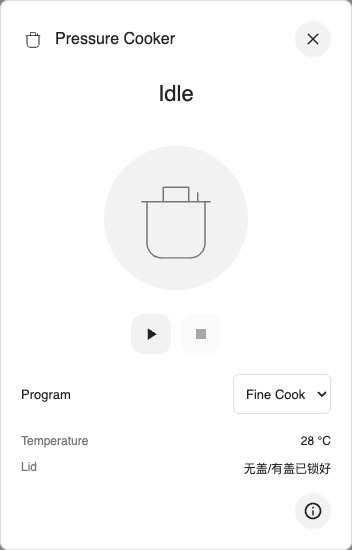

```yaml
type: custom:air-fryer-card
name: Air Fryer
state_entity: sensor.fryer_status
start_entity: notify.fryer_start
stop_entity: button.fryer_cancel
pause_entity: button.fryer_pause
resume_entity: button.fryer_resume
target_temperature_entity: number.fryer_temperature
target_time_entity: number.fryer_duration
remaining_entity: sensor.fryer_remaining
fault_entity: sensor.fryer_fault
finished_entity: event.fryer_finished
```

For `careli.fryer.maf01`, bind Start to the custom `notify.*start_cook_a_3_1`
action, not the standard start button. Its `action params` must match
`[recipe-id, recipe-name, work-time, work-temp, appoint-time, food-quanty, preheat-switch]`.
Start submits `["M1","manual",duration,temperature,0,1,0]` in one
`notify.send_message` call and waits for `Cooking`. Invalid or unavailable
temperature/duration values disable Start. Other fryers can still bind a button.
Editing settings does not start cooking; Start retains its safety confirmation.

```yaml
type: custom:pressure-cooker-card
name: Cooker
state_entity: sensor.cooker_status
start_entity: notify.cooker_start
stop_entity: button.cooker_cancel
remaining_entity: sensor.cooker_remaining
fault_entity: sensor.cooker_fault
temperature_entity: sensor.cooker_temperature
cover_entity: sensor.cooker_lid
stage_entity: sensor.cooker_stage
taste_entity: sensor.cooker_texture
error_entity: sensor.cooker_error
finished_entity: event.cooker_finished
modes:
  - label: Fine Cook
    value: 1
  - label: Soup
    value: 6
```

Program values are device-specific: these examples match `chunmi.pre_cooker.mini1`.
The cooker action uses Xiaomi Home's targeted `notify.send_message` action,
with an integer JSON array such as `[6]`; it is not an email notification.
Use only values verified against your model's MIoT specification. The card does
not install or replace an integration. All bindings except status are optional;
unbound controls are hidden. The visual editor exposes bindings and program JSON.
Temperature and duration use the number entity's bounds and step, with explicit
check buttons to apply edits. Start is blocked until pending edits are applied.
Start and Stop ask for confirmation; commands wait for actual state readback,
not just service acknowledgment. Timeout errors are visible. Closing cancels
waiting, not a command already sent. Cooking stages and remaining time are
hidden while idle. Lid values are shown verbatim, not inferred as safe or closed.
The mini1 value `无盖/有盖已锁好` does not distinguish a missing lid from a locked lid.
Never rely on the card as an appliance safety interlock. Browser tests use mock
services only; no physical cooking cycle is started by the test suite.

### Washer

`custom:washer-card` shows one compact status tile. Tap it to open Start and Stop,
Delay and estimated finish. Both buttons stay visible: Start is disabled while
running, Stop is disabled while idle, and both are disabled during commands.
Colors and sizing follow the other device cards.
Start sends `wake_up` when sleeping, waits for a ready state and
Remote Start permission, then sends `start`. Commands are confirmed by live
state updates, with a 30-second timeout per stage and visible cloud errors.
Remote Start must be enabled on the appliance; the card cannot grant permission.
Closing the panel cancels any subsequent commands, not commands already sent.
Off and Finished require preparing the appliance before Start is enabled.
Scheduled waiting and rinse hold are distinct from active washing. A Start
command may be confirmed by Scheduled when a delay was configured.
Delay changes also wait for a value readback; acknowledgment alone is not success.
No physical outlet is switched, and no program-selection capability is implied.

```yaml
type: custom:washer-card
name: Washer
state_entity: sensor.laundry_washer_current_status
operation_entity: select.laundry_washer_operation
remote_start_entity: binary_sensor.laundry_washer_remote_start
finish_entity: sensor.laundry_washer_remaining_time
delay_entity: number.laundry_washer_delayed_end
delay_min: 3
scheduled_finish_entity: sensor.laundry_washer_delayed_end
total_time_entity: sensor.laundry_washer_total_time
cycles_entity: sensor.laundry_washer_cycles
notification_entity: event.laundry_washer_notification
error_entity: event.laundry_washer_error
```

The official LG ThinQ entity values are supported. `state_entity` and
`operation_entity` are required; the other bindings are optional. `delay_entity`
also accepts an existing `input_select`. A visual editor exposes these bindings.
`delay_min` optionally overrides a number entity's lower bound using the device's
actual profile. A current value outside the writable range (such as zero) is
shown as read-only and cannot be submitted. The example's 3-hour minimum is
device-specific. Cycle duration is hidden when off or finished; event history
is only shown with a valid event timestamp, never inferred from event metadata.
These events do not provide a live door or door-lock state.

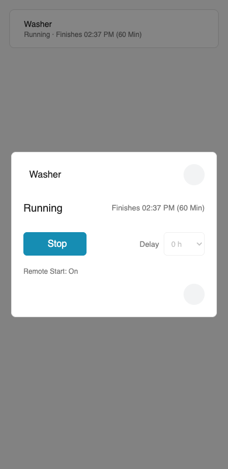

### Power Strip

A single compact tile shows the strip icon and `4 On · 2 Off`.
Tap to open a two-column panel with independent outlet controls.

- Any number of existing `switch` and `light` entities.
- Per-outlet names, icons, ordering and optional action confirmation.
- Live on/off/unavailable counts; unavailable outlets cannot be operated.
- Individual service errors displayed in the panel.
- Visual editor with entity selection and reordering.
- Nine artwork options, including Chinese five-hole sockets, staggered layouts,
  decorative USB ports, and left/right power cords.
- No master switch, new entities, automation changes or external network calls.
- Theme-aware styling, keyboard-accessible modal and 32px strip icon.

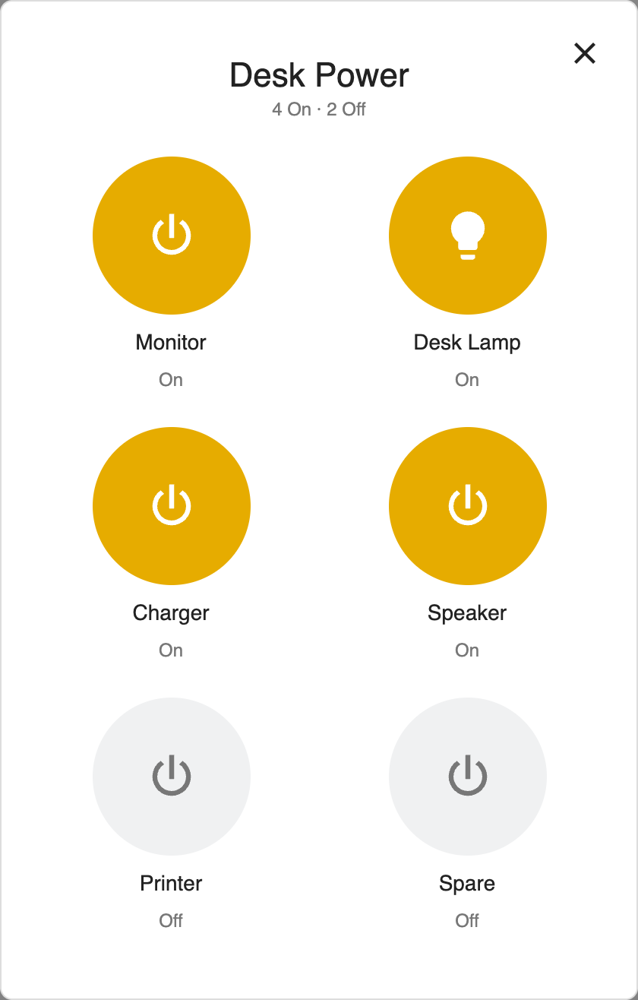

### Stereo and home theater

- `custom:homepod-stereo-card`: a HomePod or HomePod mini stereo pair.
- `custom:apple-theater-card`: an Apple TV with two or four already configured
  HomePods. Two speakers are Left and Right; four speakers are Front Left,
  Front Right, Rear Left and Rear Right.
- `custom:general-speaker-stereo-card`: a stereo player, such as a Sonos pair.
  Optional left/right entities provide individual status.

Each has a visual editor. The tile opens playback, volume and member status.
Unsupported controls are hidden; unknown volume is never presented as zero.
Commands go to **one player**, never blindly to all members.
By default this is the configured `entity`, with an optional `volume_entity`.
To follow other sources, set `playback_entities` to an ordered list of additional
controllable HA media players (for example a Music Assistant room and native HomePods).
The first playing/buffering source wins, with the primary checked first.
A paused source (or MA's idle state with retained media) is retained for resume;
otherwise the first resumable source is used,
falling back to the primary. Alternate sources use their own volume control;
`volume_entity` applies only to the primary. Internal player names are not displayed.
Controls remain limited by what the selected HA integration actually supports;
an activity status alone does not guarantee control over every external AirPlay source.
Member buttons open native HA details.

| HomePod Stereo | Apple Theater |
| --- | --- |
| 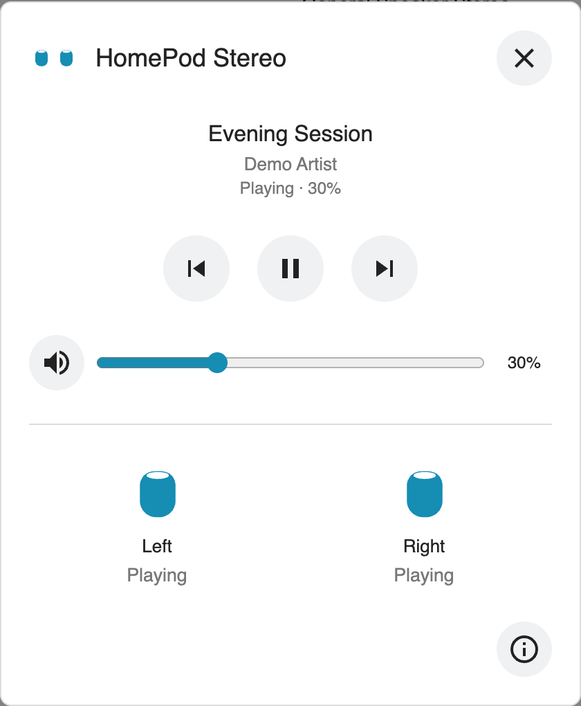 | 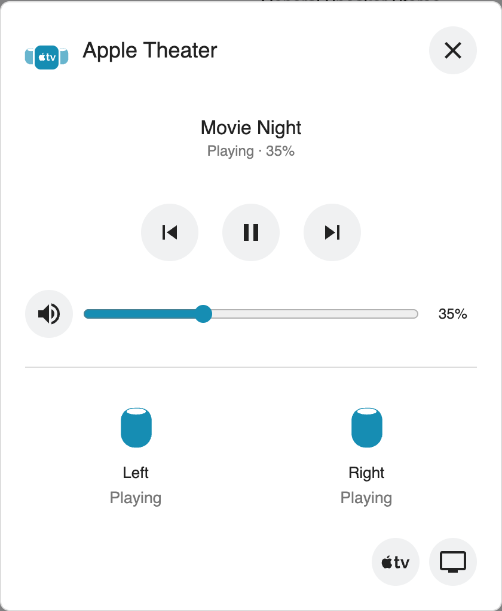 |

The combined icon is active when a player or speaker is `playing` or `buffering`,
or the optional physical television is powered on.
Paused and idle audio players stay gray; availability alone does not imply playback.
Member icons in the dialog follow their own status independently.
Colors inherit HA's media-player active/inactive theme colors.
For integrations that miss AirPlay activity,
`speaker_state_entities` accepts an optional parallel list of activity entities
(for example HA's Music Assistant players). These affect display only, never
service targets. Native `playing` takes precedence; otherwise an available
activity entity supplies the status, with fallback to the native entity.

```yaml
type: custom:homepod-stereo-card
name: Bedroom Stereo
entity: media_player.bedroom_stereo
model: mini
speakers:
  - media_player.bedroom_left
  - media_player.bedroom_right
```

```yaml
type: custom:apple-theater-card
name: Home Theater
entity: media_player.theater_apple_tv
volume_entity: media_player.theater_audio
television: media_player.theater_tv
playback_entities:
  - media_player.music_assistant_theater
  - media_player.theater_audio
model: homepod
speakers:
  - media_player.front_left
  - media_player.front_right
  - media_player.rear_left
  - media_player.rear_right
```

```yaml
type: custom:general-speaker-stereo-card
name: Stereo
entity: media_player.stereo
```

`television` is an optional details shortcut, not another playback target.
The theater layout describes your existing system. It does not pair speakers,
enable surround sound, synchronize independent players, or claim HA can control
features it does not expose. Select the real playback coordinator yourself.
Community HomePod artwork is MIT-licensed, not Apple's proprietary icons.

## Install with HACS

[](https://my.home-assistant.io/redirect/hacs_repository/?owner=rz467fzs7d&repository=home-assistant-device-cards&category=plugin)

Add `https://github.com/rz467fzs7d/home-assistant-device-cards` as a custom
repository in HACS, category **Dashboard**, and download the release.
This repository is not yet included in the default HACS catalog.

Check that the dashboard resource is registered once as a JavaScript module:

```text
/hacsfiles/home-assistant-device-cards/home-assistant-device-cards.js
```

Refresh the browser. Add **Power Strip** through the dashboard card picker.
No Home Assistant restart is needed.

## Configuration

```yaml
type: custom:power-strip-card
name: Power Strip
icon_variant: cn-six-usb
entities:
  - entity: switch.desk_outlet
    name: Monitor
  - entity: light.desk_lamp
    name: Desk Lamp
    icon: mdi:lightbulb
  - entity: switch.appliance_outlet
    name: Appliance
    confirmation: Change appliance power?
```

`entities` also accepts bare entity IDs. `confirmation` accepts a message or
`true`. Names default to `Outlet 1`, `Outlet 2`, etc.
The icon is decorative: its socket count does not represent the actual count.
Actual counts and the controls reflect the configured entities.

Choose **Appearance** in the visual editor, or set `icon_variant`:

| Value | Artwork |
| --- | --- |
| `default` | Original power strip |
| `cn-six-usb` | Six staggered sockets with four decorative USB ports |
| `cn-six` | Six staggered sockets without USB |
| `cn-four-inline` / `cn-five-inline` | Four or five inline sockets |
| `cn-four-cord-left` / `cn-four-cord-right` | Four inline sockets with a left/right cord |
| `cn-five-cord-left` / `cn-five-cord-right` | Five inline sockets with a left/right cord |

All `cn-*` artwork uses Chinese five-hole socket markings. Changing appearance
does not change the number of controls or their entity bindings.

## Migrating the standalone card

Existing `custom:power-strip-card` configurations remain compatible.
Remove the old `power-strip-card.js` dashboard resource when adding this library,
then refresh all clients. Do not load both resources together.
The icon is embedded in the bundle; the old separately hosted SVG is no longer required.

## AdGuard Home

One compact device tile with protection status, blocked-query percentage and DNS
response time. Open it to manage Protection, Filtering, Safe Browsing, Safe
Search and Parental Control, alongside seven DNS statistics. Query logging is
an administrative setting and is not shown among the protection controls.
Opening the card never changes a setting. Controls use the existing Home
Assistant AdGuard switch entities; missing or unavailable controls are disabled.
Protection is the master switch, available directly on the tile and separately
above the four settings in the details. Turning it off pauses protection without
changing any individual setting; turning it on resumes the saved configuration.

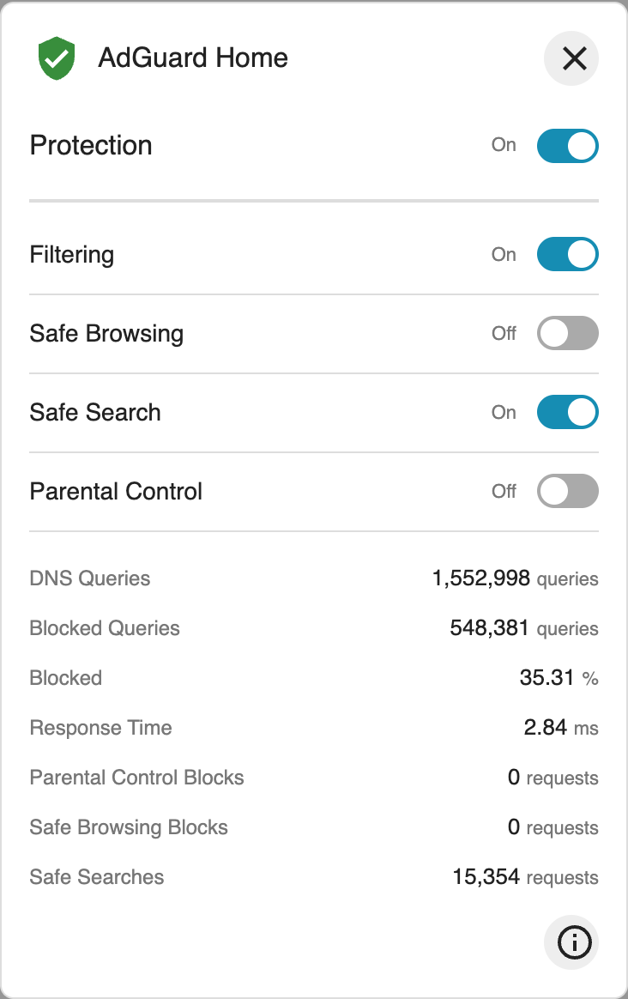

```yaml
type: custom:adguard-card
name: AdGuard Home
entity_prefix: adguard_home
```

The prefix maps to `switch.adguard_home_protection`,
`sensor.adguard_home_dns_queries` and the other standard AdGuard integration
entities. The visual editor supports individual bindings. In YAML, override any
binding with `<suffix>_entity`, for example `protection_entity: switch.my_dns` or
`average_processing_speed_entity: sensor.my_dns_latency`. Statistics retain the
integration's reporting period; they are not assumed to be daily counts.

## Development

```sh
npm ci
npm run build
npm test
```

Cards live under `src/cards/`; `src/index.js` registers the library.
Add shared utilities only when multiple cards actually need them.
The build emits one self-contained module, including the icon.

Regenerate the documentation screenshots after building:

```sh
node scripts/screenshots.mjs
```

This uses synthetic data and local Chrome (or `PW_CHANNEL=chromium`).
It downloads pinned MDI SVGs for the screenshot fixture only; the cards do not
make those network calls.

## Releases

Use semantic versions. Update `package.json` and lockfile for every release.
Push a matching `vX.Y.Z` tag; GitHub Actions builds, tests and publishes the
downloadable module. HACS updates use GitHub releases.

## License

MIT for code; CC0 for the selected Powerstrip artwork. See [NOTICE.md](NOTICE.md).
